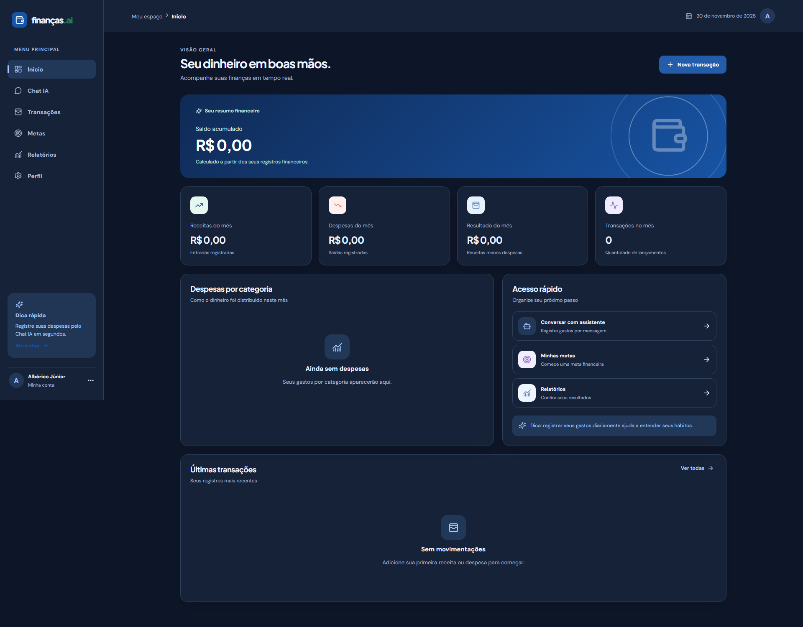
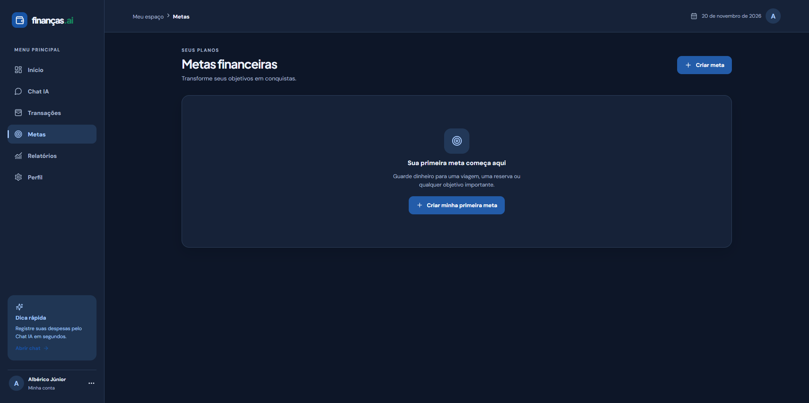
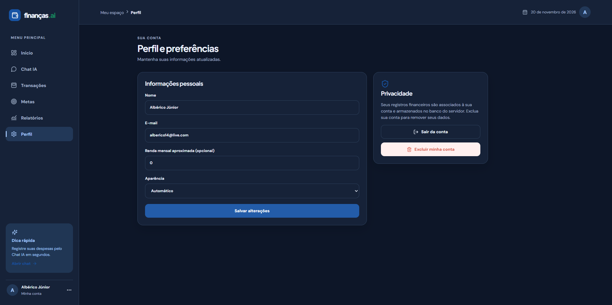

<div align="center">

# Finanças AI

### Mais clareza para cuidar do seu dinheiro.

Organize receitas e despesas, acompanhe seus objetivos e entenda melhor seus hábitos financeiros — tudo em um só lugar.

</div>

---

## ✨ Conheça o Finanças AI

O Finanças AI é um espaço simples para você cuidar da sua vida financeira no dia a dia. Veja como está seu dinheiro, registre movimentações, planeje metas e acompanhe sua evolução com mais tranquilidade.

## 💚 O que você pode fazer

- **Acompanhar seu mês:** veja seu saldo, suas receitas, despesas e as movimentações mais recentes.
- **Organizar seus lançamentos:** registre entradas e gastos, encontre o que procura e mantenha tudo em ordem.
- **Conversar com o assistente:** pergunte sobre seus registros ou descreva uma movimentação. Você confirma antes de ela ser adicionada.
- **Planejar metas:** escolha um objetivo, defina quanto quer juntar e acompanhe seu progresso.
- **Entender sua evolução:** compare receitas e despesas e veja como seus resultados mudam ao longo dos meses.
- **Personalizar seu espaço:** atualize suas informações e escolha a aparência que preferir.
- **Levar seus registros com você:** exporte suas movimentações para uma planilha.

## 📸 Veja por dentro

<table>
  <tr>
    <td align="center"><strong>Início</strong><br></td>
    <td align="center"><strong>Transações</strong><br></td>
  </tr>
  <tr>
    <td align="center"><strong>Metas</strong><br></td>
    <td align="center"><strong>Relatórios</strong><br></td>
  </tr>
  <tr>
    <td align="center"><strong>Assistente financeiro</strong><br></td>
    <td align="center"><strong>Perfil</strong><br></td>
  </tr>
</table>

## 🚀 Como experimentar

Para executar o projeto no seu computador, você precisa ter o **Node.js 22.12 ou mais recente** instalado.

1. Abra o terminal na pasta do projeto.
2. Instale os itens necessários:

   ```powershell
   npm install
   ```

3. Inicie o Finanças AI:

   ```powershell
   npm run dev
   ```

4. Acesse [http://localhost:5173](http://localhost:5173) no navegador e crie sua conta.

## 🔒 Um cuidado importante

O assistente não acessa sua conta bancária nem realiza pagamentos. Quando uma movimentação é sugerida pela conversa, você pode revisar e confirmar antes de registrá-la.

Se o assistente estiver conectado a um serviço externo de inteligência artificial, sua mensagem e um resumo das suas finanças poderão ser enviados a esse serviço para gerar a resposta. Evite compartilhar senhas ou dados bancários na conversa.

## Publicação e configuração

Consulte [o guia de publicação na Vercel com API persistente](docs/DEPLOY.md). Copie `.env.example` para `.env` somente para seu ambiente local; nunca versione as credenciais.
