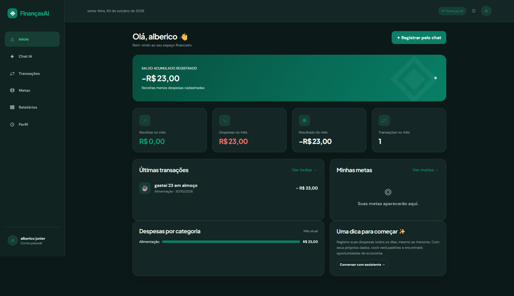
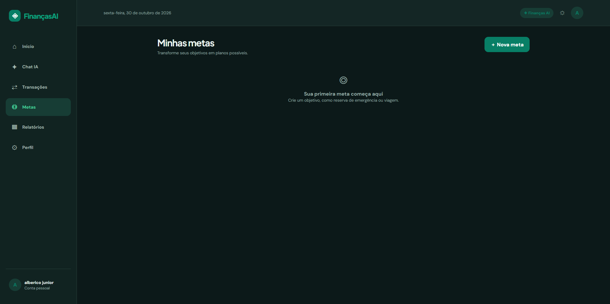
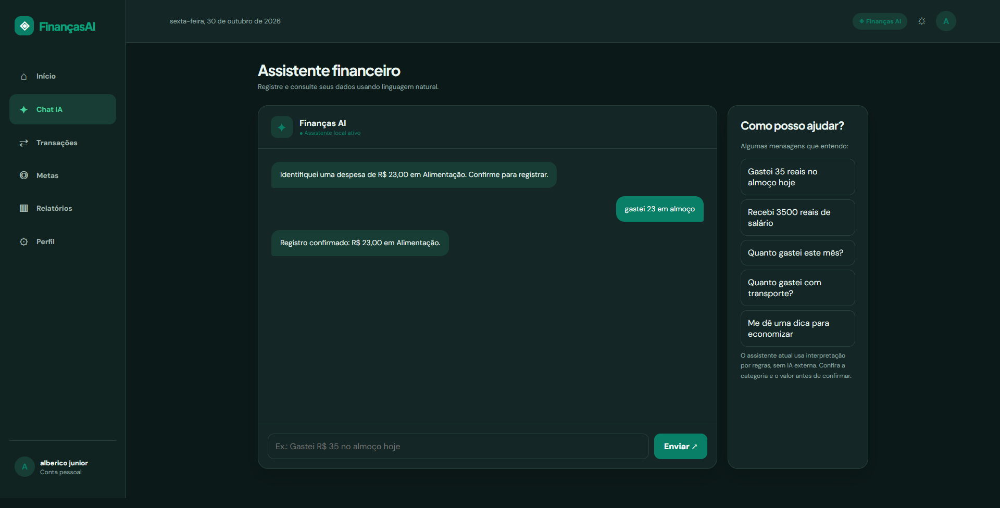
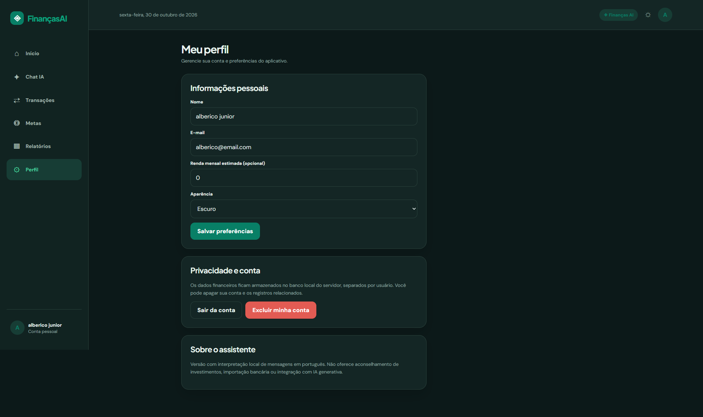

# Finanças AI

Aplicação web de controle financeiro pessoal para registrar receitas e despesas, acompanhar metas e visualizar relatórios. Os dados ficam em um banco SQLite local, e o assistente permite consultar informações e preparar lançamentos em linguagem natural — sempre com confirmação antes de salvar.


## Visão geral

### Início

Resumo do saldo acumulado a partir dos lançamentos cadastrados, movimentações do mês, transações recentes e despesas por categoria.



### Transações

Cadastro manual de receitas e despesas, com edição, exclusão e filtros por texto, tipo e mês.


### Metas

Criação e acompanhamento de objetivos financeiros, com valor desejado, prazo opcional e registro manual de contribuições.



### Relatórios

Comparativo de receitas e despesas e resultados mensais dos últimos seis meses, além da distribuição das despesas por categoria.


### Assistente financeiro

Consultas e registro de receitas e despesas por mensagens em português. O assistente interpreta frases compatíveis com as regras locais e pede confirmação antes de criar uma transação.



### Perfil e preferências

Edição de nome, renda mensal estimada e aparência, com opções de tema claro, escuro ou automático. Também é possível sair ou excluir a conta e seus dados.



## Funcionalidades

- Cadastro, login e logout com sessão.
- Painel calculado com os lançamentos da conta.
- Registro, edição, busca, filtragem e exclusão de receitas e despesas.
- Categorias para organizar as movimentações.
- Metas com prazo opcional e contribuições registradas manualmente.
- Relatórios de receitas e despesas dos últimos seis meses.
- Assistente local para consultas financeiras simples, dicas baseadas nos dados e preparação de transações com etapa de confirmação.
- Perfil com renda mensal estimada e preferências de tema.
- Layout responsivo, estados vazios e interface em português.

## Tecnologias

- **Servidor:** Node.js e Express 5.
- **Interface:** HTML, CSS e JavaScript.
- **Persistência:** SQLite com `better-sqlite3`.
- **Autenticação:** senhas protegidas com `bcryptjs` e sessões armazenadas no banco.
- **Proteções HTTP:** Helmet, limitação de requisições e validação de origem nas operações de escrita da API.

## Requisitos

- Node.js **20 ou superior**.
- npm, incluído com o Node.js.

## Instalação e execução

No terminal, a partir da pasta do projeto:

```bash
npm ci
npm start
```

Abra [http://localhost:3000](http://localhost:3000) no navegador e crie uma conta.

Para desenvolvimento com reinicialização automática ao alterar arquivos:

```bash
npm run dev
```

O servidor cria a pasta `data/` e o banco `data/financas.sqlite` na primeira execução, caso ainda não existam. A aplicação precisa ser executada pelo servidor Node.js; abrir `public/index.html` diretamente não inicia a API.

## Configuração

O servidor carrega variáveis de ambiente com `dotenv`. A porta padrão é `3000`; ela pode ser alterada definindo `PORT`. Para execução local, não é necessário configurar outras variáveis.

Em produção:

| Variável | Uso |
| --- | --- |
| `PORT` | Porta HTTP do servidor. Opcional; o padrão é `3000`. |
| `NODE_ENV` | Defina como `production` para habilitar o atributo `Secure` no cookie de sessão. |
| `SESSION_SECRET` | Segredo de sessão obrigatório em produção, com pelo menos 32 caracteres. |

As variáveis podem ser definidas no ambiente de execução ou em um arquivo `.env` na raiz do projeto. Esse arquivo é ignorado pelo Git e não deve ser compartilhado nem versionado. No código atual, `SESSION_SECRET` é validada na inicialização em produção, mas não é usada para assinar ou criptografar as sessões: elas usam identificadores aleatórios armazenados no SQLite. Use HTTPS em produção.

## Dados e privacidade

- Os dados da aplicação são persistidos localmente em `data/financas.sqlite`; o SQLite também pode criar arquivos auxiliares `-wal` e `-shm`.
- Não há integração com Supabase, PostgreSQL, Open Finance ou sincronização bancária.
- As metas e contribuições são registros de acompanhamento: não movimentam dinheiro nem alteram o saldo das transações.
- O saldo representa somente receitas menos despesas lançadas na aplicação; não é o saldo de uma conta bancária.
- A exclusão da conta remove os dados associados. Não há rotina de backup ou recuperação automática.
- Não use dados financeiros reais em uma implantação pública sem antes configurar e avaliar controles de produção, backups, monitoramento, privacidade e obrigações legais aplicáveis.

## Limitações conhecidas

- O assistente usa interpretação determinística de mensagens em português. Ele entende apenas os padrões implementados; frases ambíguas ou consultas complexas podem não ser reconhecidas.
- As transações sugeridas pelo assistente precisam ser revisadas e confirmadas. A confirmação pendente expira após 15 minutos.
- Metas devem ser criadas na tela **Metas**; o assistente não cria metas por conversa.
- `OPENAI_API_KEY` não é necessária nem utilizada pela versão atual.
- Não há recuperação de senha por e-mail, verificação de e-mail, autenticação multifator, Open Finance ou aconselhamento de investimentos.
- A aplicação não inclui configuração de implantação, proxy reverso ou armazenamento gerenciado de sessões para produção.

## Estrutura do projeto

```text
.
├── data/                 # Banco SQLite e arquivos auxiliares gerados localmente
├── img/                  # Capturas de tela incluídas neste README
├── public/
│   ├── app.js             # Interface e comunicação com a API
│   ├── index.html         # Documento principal
│   └── style.css          # Estilos, temas e layout responsivo
├── package.json           # Scripts e dependências do projeto
├── package-lock.json      # Versões resolvidas das dependências
├── server.js              # API Express, autenticação e acesso ao SQLite
└── README.md
```

## API

As rotas da aplicação usam o prefixo `/api`. Cadastro, login e verificação de saúde não exigem sessão; as demais rotas exigem uma sessão válida.

| Método | Rota | Descrição |
| --- | --- | --- |
| `GET` | `/api/health` | Verifica se o servidor está respondendo. |
| `POST` | `/api/auth/register` | Cria uma conta. |
| `POST` | `/api/auth/login` | Inicia uma sessão. |
| `POST` | `/api/auth/logout` | Encerra a sessão atual. |
| `GET`, `PATCH`, `DELETE` | `/api/me` | Consulta, atualiza ou exclui a conta atual. |
| `GET` | `/api/dashboard` | Obtém os indicadores do painel. |
| `GET`, `POST` | `/api/transactions` | Lista ou cria transações. |
| `PATCH`, `DELETE` | `/api/transactions/:id` | Atualiza ou exclui uma transação. |
| `GET`, `POST` | `/api/goals` | Lista ou cria metas. |
| `PATCH`, `DELETE` | `/api/goals/:id` | Atualiza ou exclui uma meta. |
| `POST` | `/api/goals/:id/contributions` | Registra uma contribuição para uma meta. |
| `GET` | `/api/reports` | Obtém os dados dos relatórios. |
| `GET`, `POST` | `/api/chat` | Consulta o histórico ou envia uma mensagem ao assistente. |
| `POST` | `/api/chat/confirm/:id` | Confirma uma transação sugerida pelo assistente. |
| `POST` | `/api/chat/cancel/:id` | Cancela uma transação pendente. |

## Segurança

O projeto inclui hash de senhas com bcrypt, cookies de sessão `HttpOnly` e `SameSite=Strict`, consultas parametrizadas, verificação de propriedade dos registros, cabeçalhos HTTP pelo Helmet e limitadores de requisições. Essas medidas não substituem uma revisão de segurança nem uma configuração adequada para produção. Configure um `SESSION_SECRET` forte, HTTPS, backups protegidos e os controles operacionais necessários antes de disponibilizar o serviço a outras pessoas.

## Testes

Execute os testes disponíveis com:

```bash
npm test
```

O comando usa o executor de testes nativo do Node.js. No estado atual do projeto, ainda não há arquivos de teste automatizados.
